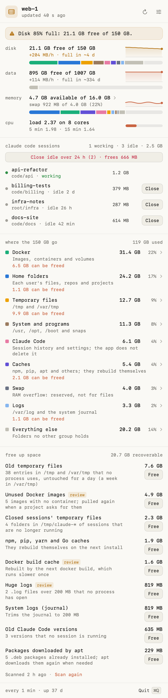
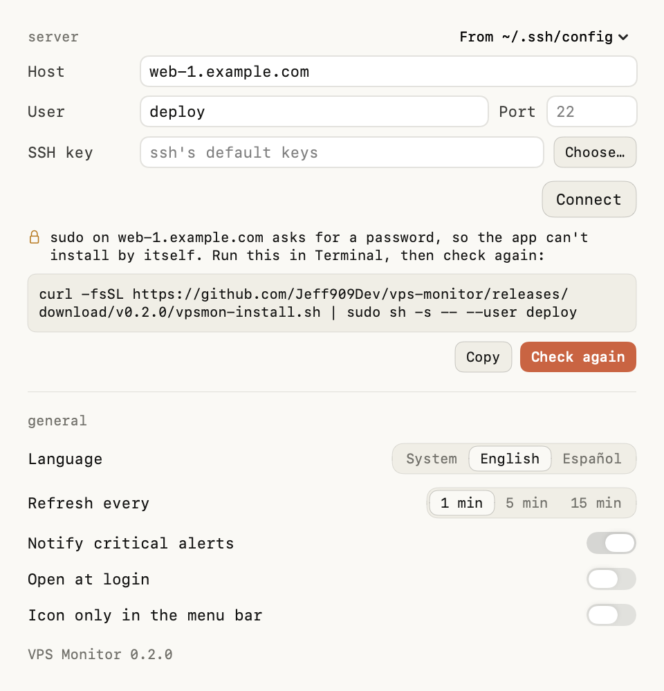
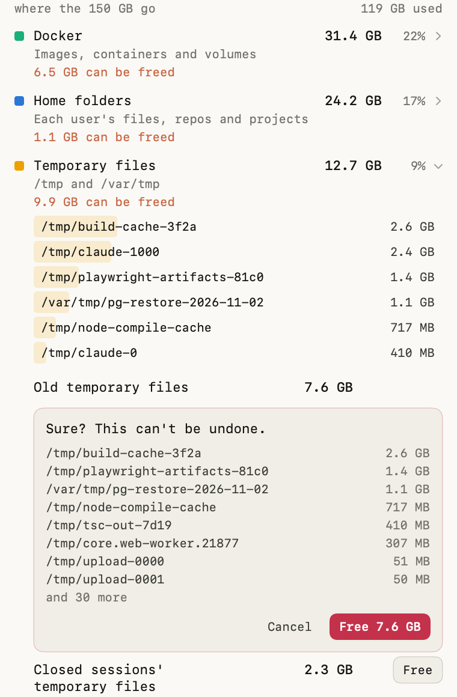
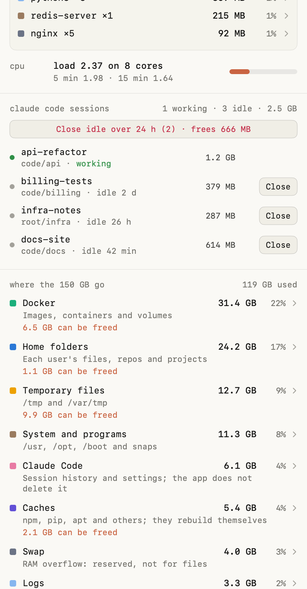

<h1 align="center">VPS Monitor</h1>

<p align="center">
  A macOS menu bar app that watches a Linux server over SSH.<br>
  See where the disk and the memory go, and free them with one confirmed click.
</p>

<p align="center">
  <a href="https://github.com/Jeff909Dev/vps-monitor/releases/latest"></a>
  <a href="LICENSE"></a>
  
  
</p>

<p align="center">
  
</p>

VPS Monitor watches one Linux server from your Mac's menu bar. It shows the free space on each disk and where the space goes, the RAM that each program uses, the CPU load, failed services, out-of-memory kills, and the Claude Code sessions on the server if it runs any. When the disk or the memory runs short, you free it from the same popover with one confirmed click. The app connects to the server over SSH and runs one script there, `vpsmon`, which it installs. The app is in English and Spanish.

## Features

- The menu bar shows the worst alert, such as `Disk 92%`, or `Disk data 92%` for a disk other than the root, with the icon in orange for a warning and in red for a critical alert.
- Each disk on the server has its own row with the free space, how fast it fills, and when it will be full at that rate. The root filesystem comes first, then volumes such as `/mnt/data`, named by the last part of their path.
- A disk map splits the used space of the root filesystem into groups that add up to all of it, such as Docker, home folders, caches, logs, and temporary files. Click a group to see its biggest folders and what you can free there.
- Click the memory row to see the programs that use the most RAM. Click a program to see its processes.
- Alerts cover failed systemd units, the units you choose to watch, and processes that the kernel or earlyoom killed for lack of memory.
- The popover offers ten disk cleanups and can end a process. Each action asks first and lists what it will touch.
- On a server that runs Claude Code, the popover lists each session as working or idle, and you can close the idle ones.
- With **Notify critical alerts** on, macOS notifies you of each new critical alert.
- **Language** in Settings switches between English and Spanish, or follows the Mac.

## Install

1. Download `VPS-Monitor-<version>-mac.dmg` from the [latest release](https://github.com/Jeff909Dev/vps-monitor/releases/latest).
2. Open the .dmg and drag **VPS Monitor** to **Applications**.
3. Open VPS Monitor. macOS blocks the first launch because the app is not notarized. Follow the steps in [the first launch on macOS](#first-launch-on-macos).
4. Click the server icon in the menu bar, then click **Connect a server…**. Continue with [Connect a server](#connect-a-server).

The release also has `VPS-Monitor-<version>-mac.zip`, which holds the same app. The app runs on Apple silicon and Intel Macs with macOS 14 or later. It runs in the menu bar and has no Dock icon.

### First launch on macOS

VPS Monitor is ad-hoc signed and not notarized, because notarization needs a paid Apple Developer ID. On macOS 15 and later, Control-click and **Open** no longer skip the warning.

1. Open VPS Monitor, and close the warning.
2. Open **System Settings** and go to **Privacy & Security**.
3. In the **Security** section, click **Open Anyway** next to the message about VPS Monitor. The button stays there for about an hour after the blocked launch.
4. Click **Open Anyway** again, and enter your password.

If you use Terminal, you can remove the quarantine flag instead:

```sh
xattr -dr com.apple.quarantine "/Applications/VPS Monitor.app"
```

### Check a download

Each release has a `SHA256SUMS.txt` file and a build attestation from GitHub Actions. The attestation proves which commit and which workflow built each file. It does not replace notarization.

```sh
shasum -a 256 -c --ignore-missing SHA256SUMS.txt
gh attestation verify VPS-Monitor-<version>-mac.dmg -R Jeff909Dev/vps-monitor
```

Check `vpsmon-install.sh` the same way before you run it by hand.

## What the server needs

- Linux with systemd. vpsmon also runs without systemd, but then it records no history.
- Python 3.10 or later.
- SSH access with a key.
- root, or a user with sudo.

CI tests the server side on Ubuntu 24.04. The Docker, journal, and apt cleanups appear only on a server that has `docker`, `journalctl`, or `apt-get`.

## Connect a server

1. Click **Connect a server…**, or click the **Settings** button at the top of the popover.
2. Type the **Host**. Leave **User**, **Port**, and **SSH key** empty to use what `ssh` would use from your `~/.ssh/config` and its default keys.
3. To fill the fields from a `Host` entry in your `~/.ssh/config`, choose it in **From ~/.ssh/config**.
4. Click **Connect**. The app runs `vpsmon status` on the server, and saves the server.
5. If vpsmon isn't installed, click **Install on server**. The app sends its bundled installer to the server over SSH, runs it, and connects again.

When the SSH user is not root, the installer adds a sudoers line. With that line, this user can run vpsmon as root without a password, and no other command.

When the app carries a newer vpsmon than the server has, the app shows **Update server**. Click it to install the new version.

### When sudo asks for a password

The app can't type your sudo password. When sudo asks for one, Settings shows a command instead.

<p align="center">
  
</p>

1. Click **Copy**.
2. In Terminal, log in to the server with `ssh`.
3. Paste the command, and enter your password when sudo asks for it.
4. In Settings, click **Check again**.

### Install by hand

You can run the installer yourself, for example from a provisioning script. Use the version that matches your app.

```sh
curl -fsSLO https://github.com/Jeff909Dev/vps-monitor/releases/download/v<version>/vpsmon-install.sh
sudo sh vpsmon-install.sh --user deploy --watch nginx,docker
```

| Flag | What it does |
| --- | --- |
| `--user <name>` | Adds the sudoers line for `<name>`. Give the user that the app connects as. Leave it out when the app connects as root. |
| `--watch <unit,unit>` | Writes these systemd units to `/etc/vpsmon/config.json`. It has an effect only when that file doesn't exist yet. |
| `--uninstall` | Runs `vpsmon uninstall`. |

The installer checks every input before it changes anything. It prints one JSON line that lists what it changed. When everything is current, running it again changes nothing.

### Watch services

VPS Monitor always shows the systemd units that failed. To also watch units that must keep running, list them in `/etc/vpsmon/config.json`. Edit the file as root.

```json
{ "services": ["nginx", "docker"] }
```

A listed unit that is not active raises a critical alert.

## What vpsmon puts on the server

| Path | What it is |
| --- | --- |
| `/usr/local/bin/vpsmon` | The script. It is one Python file that uses only the standard library. |
| `/etc/systemd/system/vpsmon-sample.timer`<br>`/etc/systemd/system/vpsmon-sample.service` | They run `vpsmon sample` as root every 5 minutes. Each run records one history row, and starts a disk scan in the background when the last scan started more than 6 hours ago. |
| `/var/lib/vpsmon/` | The history of the last 7 days and the result of the last scan. |
| `/etc/vpsmon/config.json` | The services to watch. |
| `/var/log/vpsmon.log` | One JSON line for each action that vpsmon applies, with the time, the user, the action, what it removed, and how much it freed. |
| `/etc/sudoers.d/vpsmon` | With `--user`, one line: `<user> ALL=(root) NOPASSWD: /usr/local/bin/vpsmon`. |

A scan measures the root filesystem with `du` and takes a few minutes. The disk map and the cleanups cover the root filesystem, where most of what fills a server lives. Other disks show their free space, growth, forecast, and alerts. It runs at the lowest CPU and disk priority, at nice 19 and in the idle IO class. **Scan again** in the popover starts one by hand.

To remove all of it, see [Uninstall](#uninstall).

## Free disk and memory

vpsmon decides what is safe to delete or end. The app shows what vpsmon offers and asks you to confirm. When you confirm, vpsmon checks each item again against the live server, and it acts only on the items that still qualify.

### Cleanups

**free up space** in the popover lists every cleanup that would free something. Each group in the disk map shows its own cleanups too. Click **Free** to open the confirmation. It lists the biggest items and says how many more there are. Click the red button, such as **Free 7.6 GB**, to delete them.

<p align="center">
  
</p>

| Cleanup | Risk | What it deletes |
| --- | --- | --- |
| Old temporary files | safe | Entries in `/tmp` untouched for 24 hours and in `/var/tmp` untouched for 7 days, that no process uses. Sockets, FIFOs, and system entries stay. |
| Closed sessions' temporary files | safe | Claude Code's folders in `/tmp/claude-<uid>/` for sessions that no longer run, untouched for 6 hours. |
| Huge logs | review | `.log` files over 200 MB that no process has open, in `/tmp`, `/var/tmp`, `/home`, `/root`, `/srv`, `/opt`, and `/var/log`. Each file is emptied, then deleted. |
| Old Claude Code versions | safe | Versions in `~/.local/share/claude/versions` older than the one that `~/.local/bin/claude` points to, that no process runs. |
| npm, pip, yarn and Go caches | safe | `~/.npm/_cacache`, `~/.cache/pip`, `~/.cache/yarn`, and `~/.cache/go-build` in every home. `~/.npm/_npx` stays. |
| System logs (journal) | safe | Archived journal files, with `journalctl --vacuum-size=200M`. |
| Packages downloaded by apt | safe | The `.deb` files in `/var/cache/apt/archives`, with `apt-get clean`. |
| Unused Docker images | review | Images that no container uses, running or stopped. |
| Unused Docker volumes | review | Dangling anonymous volumes. |
| Docker build cache | review | The reclaimable build cache, with `docker builder prune -af`. |

The app tags a **review** cleanup because it can delete something you still want. A log can hold the record of an incident, and an anonymous volume can hold the data of a removed container. Read the list before you confirm. [The contract](docs/contract.md#action-disk) gives the exact rule for each cleanup.

### End a process

Click the memory row to see the programs that use the most RAM. Click a program to see its biggest processes. **End** ends a process and every process under it. The confirmation names the process, its PID, how many child processes it also ends, and how much memory that frees.

<p align="center">
  
</p>

vpsmon sends SIGTERM, waits up to 10 seconds, then sends SIGKILL to what still runs. It refuses to end a system process, and those rows have no **End** button. That covers PID 1, kernel threads, `systemd`, `sshd`, `sudo`, `dockerd`, `containerd`, anything that runs from `/usr/sbin` or `/sbin`, vpsmon and the SSH session it runs in, and any process with one of these below it. [The contract](docs/contract.md#memgroup) has the full list.

### Claude Code sessions

On a server that runs Claude Code, the popover lists each session as working or idle. **Close** appears on a session that has been idle for 30 minutes. It ends the session and copies the command that resumes it. vpsmon also adds that command to `vpsmon-closed-sessions.md` in the Claude Code folder of the session's owner, `~/.claude` by default. **Close idle over 24 h** closes every session idle for more than a day and copies all of their resume commands. To copy a resume command without closing the session, right-click the session and choose **Copy resume command**.

## Alerts

The menu bar shows the label of the worst alert. The icon turns orange for a warning and red for a critical alert. With no alert, the menu bar shows the working Claude Code sessions out of all of them, such as `1/4`, or only the icon on a server that runs none. **Icon only in the menu bar** in Settings hides the label. The icon dims when the server can't be reached.

| Alert | Warning | Critical |
| --- | --- | --- |
| Disk free, for each disk | under 15% | under 5% |
| Disk full, for each disk | | within 24 hours, at the rate of the last 24 hours |
| RAM available | under 12.5% | under 6.25% |
| Swap used | over 90% | |
| A systemd unit | | failed, or watched and not active |
| Out-of-memory kill | in the last hour | |

With **Notify critical alerts** on, macOS shows a notification once for each new critical alert, and once when 3 polls in a row fail. A notification does not repeat until its alert clears or a poll works again.

## Privacy and safety

The app has no telemetry, and its only network connection is your SSH connection. On the server, it runs only `/usr/local/bin/vpsmon` with fixed arguments, and the installer when you click **Install on server**. It never sends a command, a path, or a PID built from data. When you confirm an action, it sends back only an id that vpsmon published. [SECURITY.md](SECURITY.md) lists everything that runs as root and explains how to report a vulnerability.

## Uninstall

1. On the server, run `sudo vpsmon uninstall`. It removes the timer, its service, the sudoers rule, `/etc/vpsmon`, `/var/lib/vpsmon`, and the script. It keeps `/var/log/vpsmon.log`. Delete that file by hand if you don't need it.
2. In **Settings**, turn off **Open at login**.
3. Click **Quit** in the popover.
4. Move **VPS Monitor** from **Applications** to the Trash.

To delete the app's settings too, run `defaults delete com.jeff909dev.VPSMonitor`.

## Troubleshooting

- **"The server doesn't accept your SSH key: check the user and the key."** Check **User** and **SSH key** in Settings. The app runs `ssh` in batch mode, so it can't ask for the passphrase of a key. Add the key to the SSH agent first, for example with `ssh-add --apple-use-keychain ~/.ssh/id_ed25519`.
- **"The server's host key doesn't match the one in known_hosts."** The host key of the server changed after your first connection. If you rebuilt the server, remove the old key with `ssh-keygen -R <host>` and connect again. If you did not, find out why before you connect.
- **"vpsmon can't become root without a password: install it again to add its sudo rule."** The sudoers line is missing. Click **Install on server** in Settings, or run the installer by hand with `--user`.
- **"vpsmon needs Python 3.10 or newer on the server."** Install Python 3.10 or later on the server, then connect again.
- **The charts and the "full in" forecast stay empty.** The forecast needs an hour of history, and the timer records a row every 5 minutes. On a server without systemd, vpsmon has no timer and records no history.
- **The icon doesn't show in the menu bar.** On a Mac with a notch, macOS hides the menu bar icons that don't fit beside the menus of the open app. Remove another icon, or hold Command and drag VPS Monitor next to the clock.
- **Open at login stays off.** The app must be in **Applications**. If macOS asks, allow it in **System Settings** > **General** > **Login Items**.

## Build from source

A build that you make on your own Mac has no quarantine flag, so macOS opens it without a warning. You need macOS 14 or later and Xcode 16 or later. The server tests need Python 3.10 or later.

```sh
git clone https://github.com/Jeff909Dev/vps-monitor.git
cd vps-monitor
make test   # the app and server unit tests
make app    # build/VPS Monitor.app
make run    # build the app and open it
```

`make test` does not connect to any server. `make dist` builds the same .dmg, .zip, and installer as a release. [CONTRIBUTING.md](CONTRIBUTING.md) explains how to test the server side on a machine you can throw away. [docs/contract.md](docs/contract.md) describes every vpsmon command and every rule that vpsmon applies.

## Limitations

- The app is not notarized. See [the first launch on macOS](#first-launch-on-macos).
- The app watches one server at a time.
- It watches only the root filesystem, `/`.
- The history needs systemd. On a server without it, the charts, the "full in" forecast, and the list of services stay empty.
- The RAM of a process is `RssAnon + VmSwap` from `/proc/<pid>/status`, which is what ending the process gives back. It is close to PSS, but it is not the same number.

## License

VPS Monitor is released under the [MIT license](LICENSE). It is not affiliated with Anthropic, which makes Claude Code.
